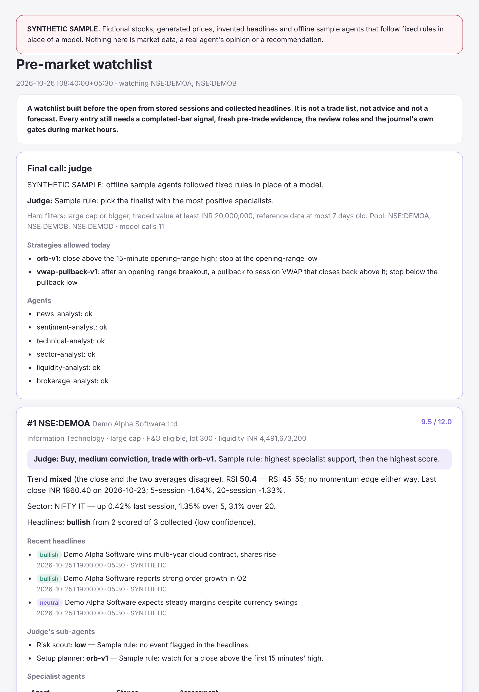

# India Trade Lab

**An AI research desk for NSE stocks that trades a virtual book, and sits out when nothing has earned the right to trade.**

Every morning, six specialist agents read the news, sentiment, charts, sectors, liquidity and broker calls for your stocks. A judge agent, helped by a risk scout and a setup planner, picks up to three to watch. All session, proven strategies trade them in a paper book under hard loss limits. Every evening, a tournament re-tests each strategy at double costs on your own history.

Paper only: there is no real-order path. No result here is a promise of profit.


**Who it is for:** Indian retail traders and developers who want to test an AI-assisted intraday process honestly, with real Zerodha data, before risking money.

## Try it in 2 minutes (no account needed)

```bash
git clone https://github.com/kaifiasif/india-trade-lab.git && cd india-trade-lab
python3 scripts/observatory.py          # then open http://127.0.0.1:8765 and press "Run paper replay"
```

Needs Python 3.10 or newer and nothing else. The replay uses a bundled synthetic session.

To see what the morning report looks like, open
`docs/examples/premarket-sample.html` in a browser after cloning: fictional stocks and rule-based
stand-in agents, clearly labelled. Meet every agent in the illustrated
[Meet the Desk guide](docs/guide/agents-guide.pdf).

[](docs/examples/premarket-sample.html)

## How a trading day works

| When (IST) | What happens | Who decides |
|---|---|---|
| 16:10 the evening before | History sync, then the strategy tournament at double costs | Code |
| 08:30 | You log in to Kite (2FA) and confirm two human checks | You |
| 08:40 | Hard filters, six specialists, the judge and its sub-agents; report emailed | Agents narrow, code filters |
| 09:15–15:15 | Live setups on judge picks are reviewed, debated and recorded in the paper book | Agents can only veto; code sizes |
| All session | Breakeven, trailing and time stops; 15:15 square-off | Code |
| Fridays | The week's paper track record is written, ready to publish | Code |

Day to day, one command covers it (`alias itl="python3 scripts/itl.py"`):

```bash
itl setup        # create the private project folder
itl login        # daily Kite login and the two human checks
itl report       # news, then the pre-market report (add --email)
itl tournament   # re-test the strategies on stored history
itl status       # what is ready, today's picks, the tournament, the book
itl track        # the paper track record as Markdown
itl dashboard    # the local dashboard, including Today's desk
```

## What to expect in week 1

- **Costs:** Kite Connect is ₹500 a month for market data. Hosting on Oracle Cloud Always Free is ₹0. The agents cost ₹0 on Gemini's free tier, or roughly ₹130 a month with Claude (13 calls each morning, plus intraday reviews you cap with `max_model_calls_per_day`).
- **Setup:** about an hour once, all from the dashboard's **Setup** page: a Kite app, 180 days of history, an email app password. Keys go into an owner-only file, never into JSON. Follow [deploy on Oracle Cloud](docs/deploy-oracle.md), or [live data setup](docs/live-data.md) to run on your own computer.
- **Daily effort:** about two minutes each morning for the Kite login and the two checks, from the dashboard on your phone.
- **First results:** the tournament may find that no strategy has earned money at double costs on your history yet. Then the desk **sits out** and records no trades. That is the safe outcome, not a fault. To collect paper trades anyway, set `"strategy": {"require_proven": false}`, for paper only.
- **Judge picks:** need a model key. Without one, the report uses the plain score ranking and says so.

## What it does

- **Pre-market report:** trend, RSI, sector moves, market-cap tier, liquidity, F&O lot size (shown, never traded), headline sentiment and broker calls per stock, from Google News, NSE filings and ET Markets. See [premarket.md](skills/day-trader-india/references/premarket.md).
- **Agents:** six specialists, a judge, and two sub-agents per finalist. Picks must name a proven strategy; code drops high-risk or setup-less picks.
- **Strategies:** an opening-range breakout and a VWAP pullback, behind trend, RSI and stop-distance filters, with breakeven, trailing and time stops. See [strategy.md](skills/day-trader-india/references/strategy.md).
- **Tournament:** replays each strategy on your history with pessimistic fills; only those profitable at double costs across periods may trade.
- **Intraday review:** six evidence roles, bull/bear and risk debates, a five-tier rating that can only stop or downgrade an entry, and decision memory. See [debate.md](skills/day-trader-india/references/debate.md).
- **Paper journal and engine:** cash, risk, daily-loss, trade-count, streak and drawdown limits; stale-quote rejection; checksummed state; restart recovery. See [engine.md](skills/day-trader-india/references/engine.md).
- **Paper autopilot:** records approved entries and every exit in the virtual book, all session (opt in).
- **Dashboard:** a React app in light and dark: Today, the pre-market desk, a paper replay, research, the agents, an 11-step Setup and Settings. Animated SVG mascots react to what the desk records. See [observatory.md](docs/observatory.md).
- **Backtests and checks:** a backtest grid with doubled costs ([backtest.md](skills/day-trader-india/references/backtest.md)), a preflight check that names every missing input and its fix, and 224 offline tests.
- **Portable skills:** 17 skills (the trading desk, a developer skill and 15 specialist roles) for Claude, Codex and other agents.

## What it does not do

- **Place real orders.** There is no broker order path. Real trading would need new code, a SEBI-registered static IP and your explicit decision.
- **Stream quotes.** The worker polls Kite quotes and candles each minute; there is no WebSocket feed.
- **Refresh the Kite login, the NSE calendar or the stock list for you.** Kite needs a daily 2FA login; the calendar and stock list are updated by hand (yearly and monthly).
- **Prove a strategy works.** A passing test checks software behaviour, not profitability. Past sessions do not predict future returns.

Broker adapters need an authorised account, the data plan and a verified instrument mapping. Authenticated broker access has been built to the documented APIs but not integration-tested by this project.

## Compared with general multi-agent trading frameworks

This project deliberately differs from frameworks where a model decides the
trade:

| | Here |
| --- | --- |
| Who sizes the position | Deterministic code, from the journal's risk caps. No model is asked for a quantity |
| What a rating can do | Stop or downgrade an entry. It can never create or enlarge one |
| Evidence | Supplied, dated and cited by ID; an uncited claim is refused |
| Hindsight | Lessons reach a debate only once their outcome was known at that cutoff |
| Execution | Paper only. There is no live order path in this repository |
| Market | NSE/BSE cash equity, INR, Asia/Kolkata, with a dated exchange calendar |

A debate makes the reasoning legible and gives a second line of refusal. It does
not make the strategy profitable, and no result here is evidence that it is.

Books and event logs live under `data/observatory/` and are retained between runs.
Historical coverage and import instructions are in [the observatory guide](docs/observatory.md).

## Command-line examples

### Run the made-up example

The bundled `NSE:DEMO` data is **synthetic**. It is not observed market history and must not be used as evidence of profitability.

```bash
python3 scripts/india_research.py scan-orb \
  --bars skills/day-trader-india/assets/synthetic-bars.csv \
  --sessions skills/day-trader-india/assets/synthetic-sessions.json \
  --as-of 2026-10-19T09:35:00+05:30

python3 scripts/india_research.py replay-orb \
  --bars skills/day-trader-india/assets/synthetic-bars.csv \
  --sessions skills/day-trader-india/assets/synthetic-sessions.json \
  --symbol NSE:DEMO --as-of 2026-10-19T15:30:00+05:30 \
  --cash 100000 --risk 250 --daily-loss 750 --position-cap 15000 \
  --target-r 2 --fee-bps 5 --fee-flat 10 --slippage-bps 5 \
  --drawdown-stop 2000
```

The replay prints a baseline and a doubled-cost scenario. Fees are explicit assumptions, not a complete Indian statutory-charge calculator. It does not model tick sizes, partial fills, spreads, market depth or exchange matching. Stop gaps can exceed the planned loss budget.

### Create a separate virtual book

This example uses a synthetic symbol and `--replay`, so every entry is labelled `replay_demo`.

```bash
python3 scripts/paper_book.py --book data/demo.sqlite init \
  --cash-inr 100000 --symbols NSE:DEMO \
  --risk-inr 250 --daily-loss-inr 750 --position-limit-inr 15000 \
  --max-trades 3 --max-open 2 --max-loss-streak 2 --drawdown-stop-inr 2000 \
  --replay

python3 scripts/paper_book.py --book data/demo.sqlite status
```

For forward manual paper practice, use a **different** book without `--replay`, allowlist verified cash-equity symbols, and supply recent authorised quotes with their original timestamps. Never merge synthetic/replay results with forward paper results. Keep personal books and broker exports out of Git.

Use command help for entries, full-position exits and pausing:

```bash
python3 scripts/paper_book.py --book data/demo.sqlite buy --help
python3 scripts/paper_book.py --book data/demo.sqlite sell --help
python3 scripts/paper_book.py --book data/demo.sqlite pause --help
```

### Replay a session through the engine

The engine applies stops, targets and the session square-off itself, through the same journal.

```bash
python3 scripts/engine.py replay \
  --bars skills/day-trader-india/assets/synthetic-bars.csv \
  --sessions skills/day-trader-india/assets/synthetic-sessions.json \
  --symbol NSE:DEMO --date 2026-10-19 --book data/engine-demo.sqlite \
  --cash 100000 --risk 250 --daily-loss 750 --position-cap 15000 \
  --target-r 2 --fee-bps 5 --fee-flat 10 --slippage-bps 5
```

### Download broker history

Read [data and tool interfaces](skills/day-trader-india/references/data-and-tools.md) first. The adapter issues GET requests only and does not place orders.

```bash
# Set KITE_API_KEY and KITE_ACCESS_TOKEN privately outside chat and Git.
# Replace the instrument token and symbol using a verified instrument master.
python3 scripts/broker_data.py --provider kite \
  --instrument VERIFIED_NUMERIC_TOKEN --symbol NSE:VERIFIED_SYMBOL \
  --from-date YYYY-MM-DD --to-date YYYY-MM-DD \
  --output data/bars.csv
```

For Upstox use `UPSTOX_ACCESS_TOKEN`, `--provider upstox`, and a verified cash-equity instrument key. Quote keys containing a pipe in your shell, for example `'NSE_EQ|VERIFIED_ISIN'`. These are placeholders, not working credentials or identifiers. Existing output files are not overwritten.

## Install the skills

The installable skills are now in [`skills/`](skills/), not the repository root.
Each folder includes its own instructions and resources.

| Skill | Use it for |
| --- | --- |
| [day-trader-india](skills/day-trader-india/SKILL.md) | Indian market research, historical evaluation and manual paper trading |
| [india-trade-dev](skills/india-trade-dev/SKILL.md) | Code reviews, tests, portable packaging and clear technical documentation |

From this checkout, choose your client:

```bash
python3 scripts/install_skills.py --platform claude --scope user --with-agents
python3 scripts/install_skills.py --platform codex --scope user --with-agents
```

These are alternatives; run the one for your client, or both if you use both.
The default installs all 17 skills. `--with-agents` also installs 15 native specialist profiles for that client. Existing files are never replaced.
Use `/day-trader-india` in Claude Code or `$day-trader-india` in Codex.

For **Claude web / Desktop**, run `python3 scripts/package_skills.py` and upload
the core ZIP and any role ZIPs you need from `dist/` in **Customize > Skills**. Full instructions for Claude,
Codex, Cursor, Copilot and other hosts are in [installation](docs/installation.md).
A skill does not start a background service or connect your broker.

## Specialist agents and guardrails

The pack includes data, news, earnings analysis, screening, disclosures, budget,
risk, paper-broker, alerts, costs/tax, rebalancing and independent reviewer roles.
See the [role map and handoff contract](skills/day-trader-india/references/agent-workflow.md).
Native Claude/Codex profiles are in [agent_profiles/](agent_profiles/). They
return research findings; the coordinator runs tools. On other hosts, invoke
role skills or follow their procedures sequentially and label that limitation.

Use this request after installation:

> Use day-trader-india to coordinate the Indian research agents. Review the data,
> news, setup, budget and risks, then have the independent reviewer challenge the
> proposal. Return DATA BLOCK for missing evidence. Keep everything virtual.

The offline workflow CLI prints dependency plans and validates handoff packets:

```bash
python3 skills/day-trader-india/scripts/agent_workflow.py plan \
  --workflow intraday --symbol NSE:DEMO \
  --as-of 2026-10-19T10:00:00+05:30 --run-id synthetic-demo
```

This plans delegation; it does not launch models or start a service. The
coordinator uses the host's subagent feature. Any veto, missing report or
changed proposal blocks review completion. A completed review never authorizes
an order or replaces the journal's gates.

Forward manual entries now require a **version-3 journal** and sourced
`--evidence` JSON. Added controls include fixed practice ceilings, supplied
session/quote/spread checks, a loss cooldown, entry halt and state checksums.
Existing accounting, duplicate, loss-streak and drawdown controls remain.
Read [guardrails and limitations](skills/day-trader-india/references/guardrails.md)
for the exact enforced/manual boundary and migration from older books. No
collection of guardrails guarantees loss-free trading or truthful input data.

## Code and writing standards

The runtime implementation lives in `skills/day-trader-india/scripts/`. The
original `scripts/broker_data.py`, `scripts/india_research.py` and
`scripts/paper_book.py` remain compatible CLI entry points. Offline regression
tests live in `tests/`; install/package/validation tools live in `scripts/`.
References and synthetic assets moved inside the trading skill so copied
installations work without this checkout.

[AGENTS.md](AGENTS.md) and [CLAUDE.md](CLAUDE.md) give coding assistants the repo
rules. [CONTRIBUTING.md](CONTRIBUTING.md) documents the development workflow and
[engineering standards](skills/india-trade-dev/references/engineering.md) define
code and writing expectations. `python scripts/check.py` runs Ruff lint,
format checks, skill metadata and local-link validation, generated-agent drift checks, and offline tests.
GitHub Actions uses the same command on Python 3.10 and 3.12 and uploads skill
ZIPs as a workflow artifact. Public function annotations support readability;
full static type checking is not enforced yet.

## Roadmap

Planned, **not implemented**:

1. A WebSocket quote stream with reconnect handling, replacing the one-minute poll.
2. Upstox live quotes and stock lists, for a ₹0 data option.
3. Mark-to-market portfolio controls and drawdown on open positions.
4. Automatic NSE calendar and instrument-master updates.

## References

- [Research lab: relative strength, patterns and model routing](skills/day-trader-india/references/research-lab.md)
- [Risk process and limitations](skills/day-trader-india/references/risk-process.md)
- [Data and CLI schemas](skills/day-trader-india/references/data-and-tools.md)
- [Broker connections and sandbox distinctions](skills/day-trader-india/references/connections.md)
- [Optional resources and ranked improvements](skills/day-trader-india/references/resources.md)
- [Comparison with the source projects](skills/day-trader-india/references/source-comparison.md)

Design influences: [Jakeschincariol/day-trader-skill](https://github.com/Jakeschincariol/day-trader-skill) and [Jakeschincariol/trader-skill](https://github.com/Jakeschincariol/trader-skill). This repository contains the India-specific implementation; it does not bundle the separately installed US skill collection. US tax, SEC and congressional-disclosure logic is not treated as Indian-market functionality.

## Licence

MIT. See [LICENSE](LICENSE).
