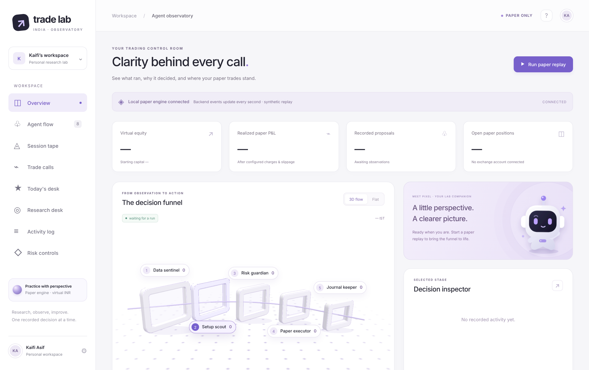

# India Trade Lab

**An AI research desk for NSE stocks that trades a virtual book, and sits out when nothing has earned the right to trade.**

Every morning, specialist agents read the news, charts, sectors and broker calls for your stocks, and a judge picks up to ten to watch. During the session, only strategies that proved themselves on your own history trade them, in a paper book with hard loss limits. Every evening, each agent is graded and learns from its mistakes.

Paper only: there is no real-order path. Nothing here is a promise of profit.



## Try it in 2 minutes

```bash
git clone https://github.com/kaifiasif/india-trade-lab.git && cd india-trade-lab
python3 scripts/observatory.py    # open http://127.0.0.1:8765, then Paper replay → Start replay
```

Needs only Python 3.10 or newer. The replay uses a bundled made-up session. To
see what the morning report looks like, open the
[sample report](docs/examples/premarket-sample.html). To meet the agents, read the
[Meet the Desk guide](docs/guide/agents-guide.pdf).

## Use it with real data

Set it up once from the dashboard's **Setup** page, which takes about an hour.
You add your Kite Connect keys, an email app password, an optional AI model key,
your stocks and 180 days of history. Keys are kept in a private file on the
server and never shown again.

To run it every day for free, follow [Deploy on Oracle Cloud](docs/deploy-oracle.md).
After that, each morning takes about two minutes: the Kite login and two checks,
from your phone.

**Costs:**

- Kite Connect: ₹500 a month.
- Oracle Cloud hosting: ₹0.
- AI agents: ₹0 on OpenRouter's or Gemini's free models. With one OpenRouter key, the desk picks the models itself and keeps paid use under your daily cap.

## A trading day

| When (IST) | What happens |
|---|---|
| 08:30 | You log in to Kite |
| 08:40 | Code scans every F&O stock: futures positioning, delivery, large deals, upcoming events |
| 09:09 | Pre-open gap against the Nifty; agents and the judge pick up to ten from the best 20; picks are emailed |
| 09:15–15:05 | Picks that pass the 09:31 volume and VWAP check are traded in the paper book; code sizes every trade |
| 15:05 | Everything is squared off (before the 15:15 closing auction) |
| 16:10 | History is saved, strategies are re-tested at double costs, and agents are graded |

If no strategy has made money at double costs on your history, the desk sits
out and records no trades. That is the safe outcome, not a fault.

## What it does

- **Market scan:** the desk picks its own stocks from every F&O name, on signals that lead the open, not only yesterday's news. See [market-scan.md](skills/day-trader-india/references/market-scan.md).
- **Pre-market report:** trend, RSI, sector moves, liquidity, headline sentiment and broker calls for each stock.
- **Agents:** six specialists, a risk scout, a setup planner and a judge. Agents can only narrow or veto; code decides size.
- **Strategies:** an opening-range breakout and a VWAP pullback, with breakeven, trailing and time stops.
- **Trade desk on a loop:** every few minutes the desk agent runs an entry timer, an exit planner, a time machine (10,000 replays of the rest of the day from the stock's own history), a budget and risk check, and price alerts for each pick. The time machine can veto a paper entry. See [trade-tools.md](skills/day-trader-india/references/trade-tools.md).
- **Swing desk:** holds of up to five sessions in its own ₹1 lakh paper book, only when volume confirms price (breakouts on 2x volume, pocket pivots, pullbacks on drying volume) and only for setups its tournament proved at double delivery costs. A swing Monte Carlo shows each plan's odds and rupee outcomes by session, and the dashboard lets you replay your own scenarios. See [swing.md](skills/day-trader-india/references/swing.md).
- **Safety rules:** no entries on stale data, when India VIX or the Nifty is wild, or when reward after costs is under 1.5x the risk. No stock in both books. Stop and target are required before entry, every intraday position is squared off by 15:05 (15:15 before the closing auction began), and the desk recovers after a restart. See [safety.md](skills/day-trader-india/references/safety.md).
- **Honest testing:** exact Zerodha charges by date; each strategy must beat 95% of random-entry twins and pass a Deflated Sharpe test that counts every variant ever tried; strategies that lose in today's market regime (Nifty trend and India VIX) sit out.
- **Exchange reality:** no entries in stocks under NSE surveillance (GSM, ASM, ESM) and caution on the F&O ban list; square-off by 15:05 for the closing auction; Muhurat is skipped.
- **Portfolio caps:** total open risk, sector, correlation and quarter-Kelly limits across both books.
- **Runs unattended:** a watchdog messages you on Telegram (or email) when a login, scan or worker is missed, and answers /status, /pause and /resume; nightly encrypted backups with a monthly restore test.
- **Performance page:** expectancy in R, equity and drawdown, attribution by strategy, regime, weekday and hour, paper-versus-backtest drift, measured slippage, a plain story of each trade and a tax estimate; emailed weekly and monthly. See [robustness.md](skills/day-trader-india/references/robustness.md).
- **Filings:** the latest quarterly results from NSE's XBRL, and SEBI insider-trading disclosures (promoter and director buying, selling and pledges), read into the morning scan.
- **Learning:** mistakes become lessons the agents read next morning, and stocks that keep losing sit out for a week.
- **Smart model routing:** simple jobs go to free models and the judge to a capped paid one. With OpenRouter, the desk chooses the models on its own record.
- **Dashboard:** setup, today's picks, replays, research and each agent's track record, in light and dark.

## What it does not do

- **Place real orders.** Real trading would need new code and your explicit decision.
- **Log in to Kite for you.** Kite requires a daily 2FA login.
- **Guarantee profit.** Past sessions do not predict future returns.

## Documentation

- [Dashboard and setup](docs/observatory.md)
- [Deploy on Oracle Cloud](docs/deploy-oracle.md) · [Run on your own computer](docs/live-data.md)
- [Pre-market report](skills/day-trader-india/references/premarket.md) · [Trade tools and the desk agent](skills/day-trader-india/references/trade-tools.md) · [Swing desk](skills/day-trader-india/references/swing.md) · [Strategies and tournament](skills/day-trader-india/references/strategy.md) · [Learning and routing](skills/day-trader-india/references/learning.md)
- [Paper engine](skills/day-trader-india/references/engine.md) · [Guardrails](skills/day-trader-india/references/guardrails.md) · [Command-line tools](skills/day-trader-india/references/data-and-tools.md)
- [Robustness, operations and analytics](skills/day-trader-india/references/robustness.md) · [Before any real money: a checklist](docs/path-to-live.md)
- [Install as skills for Claude, Codex and other agents](docs/installation.md)

## Contributing

See [CONTRIBUTING.md](CONTRIBUTING.md). `python3 scripts/check.py` runs the lint, tests and skill checks.

## Licence

MIT. See [LICENSE](LICENSE).
